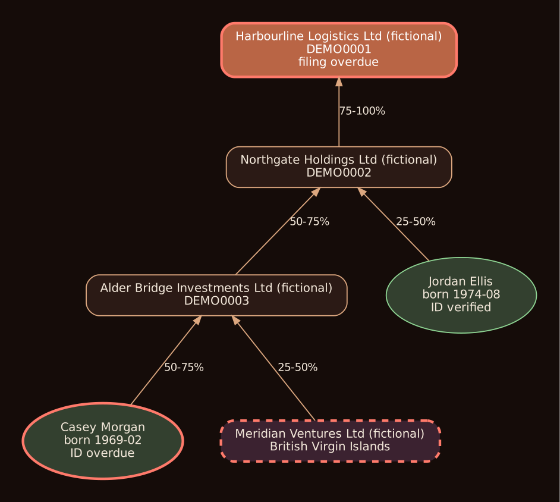
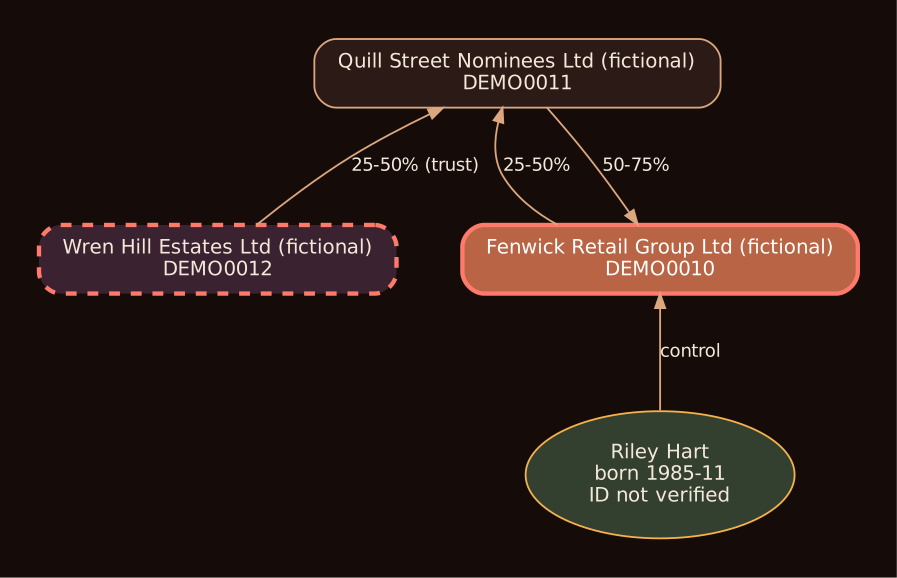

# OwnnTrak by OSH Ventures
https://ownntrak.streamlit.app

OwnnTrak is a small RegTech tool that traces who really owns and controls a UK company, using public Companies House data. It follows corporate owners up through the chain, estimates each person's beneficial ownership as a range, and flags the places where the trail goes cold.

It was built as a portfolio project to show how a compliance analyst thinks about ownership due diligence, and how that thinking turns into a repeatable, testable control.

## Look and feel

The interface blends the OSH Ventures palette (espresso, terracotta, clay, ivory and sage, set in Plus Jakarta Sans) with a dark, glowing, frosted glass style. The OwnnTrak wordmark is set in Comic Sans in pink, with "by OSH Ventures" in the OSH Ventures typography. All of it lives in `ubo_mapper/theme.py` and `.streamlit/config.toml`, so it is easy to restyle.

Comic Sans loads from the visitor's own device. Where it is not installed, such as on some Android and Linux devices, the page falls back to Comic Neue.

## The problem it addresses

When a firm onboards a corporate customer, it has to identify the beneficial owners behind it, usually anyone who ultimately owns or controls more than 25 percent (Money Laundering Regulations 2017, regulation 5). In practice the answer is rarely one click away. Ownership sits behind holding companies, overseas entities, trusts and nominee style structures, and the public register only shows bands rather than exact figures.

Analysts spend real time redrawing these chains by hand and deciding where to stop. This tool automates the tracing and makes the stopping points explicit, so the analyst's attention goes to the judgement calls.

## What it does

- Looks up a company and its persons with significant control (PSCs) through the Companies House API.
- Follows UK corporate owners upwards, to a depth you choose.
- Multiplies the published ownership bands along each chain and adds up separate chains, giving each person an estimated range.
- Classifies each person as a likely UBO, a possible UBO, control without a share band, or below threshold.
- Lists unresolved owners separately: overseas entities, protected identities, unidentified companies, and dead ends.
- Raises red flags with a severity and a plain explanation.
- Rates the structure red, amber or green on four dimensions, plus an overall rating, and shows exactly which flags drive each colour.
- Shows each person's Companies House identity verification status, and flags overdue accounts and confirmation statements.
- Draws the structure as a graph and exports a Markdown working paper and a JSON file.



*Fictional demo: two people each land between roughly 19 and 56 percent, so neither can be called a UBO from public data alone. The dashed box is an overseas owner the register cannot look through.*



*Fictional demo: circular ownership, an interest held as a trust, and an owner in liquidation.*

## RAG ratings

Every red flag belongs to one of four dimensions. A dimension is **red** if it holds any high flag, **amber** if it holds any medium flag, and **green** otherwise. Low and info flags are shown but do not change the colour. The overall rating is the worst of the four, so every colour traces back to named flags. Ratings use a shape as well as a colour, so they do not rely on colour alone.

| Dimension | What drives it |
|---|---|
| Structure complexity | Overseas and offshore owners, circular ownership, layered chains, many entities, trusts, owners resident in elevated risk jurisdictions |
| Transparency | No PSC data, PSC statements, super secure PSCs, unidentified owners, and how much of the target sits behind unresolved owners |
| Identity verification | Whether each individual PSC has verified their identity with Companies House, and whether they are overdue |
| Filings and status | Overdue or soon due accounts and confirmation statements, inactive owners, proposals to strike off, undeliverable registered offices |

The demo data includes one scenario for each outcome: two red, one amber and one green.

### Identity verification

Identity verification became mandatory at Companies House on 18 November 2025, with a 12 month transition period for existing directors and PSCs that ends on 17 November 2026. The public API publishes an optional `identity_verification_details` object on individual PSCs, and OwnnTrak reads it as follows:

- **Green:** a verification statement has been supplied, or an authorised corporate service provider has verified the person.
- **Amber:** not verified yet. The label shows the person's due date where the register gives one.
- **Red:** the person's due date has passed, or there is no record and the transition period has ended.

Two caveats. This is Companies House's own verification, and it does not replace the identity checks a firm carries out on its own customers. And a missing record can mean the person has not verified or that the register has not caught up. The end of the transition period is a single constant, `TRANSITION_END`, in `ubo_mapper/verification.py`.

### Overdue filings

The company profile carries a `next_due` date and an `overdue` flag for accounts and the confirmation statement. An overdue filing is a high flag, and one due within 30 days is a medium flag. Companies that are dissolved or closed are skipped because nothing is due.

## Red flags it raises

| Flag | Why it matters |
|---|---|
| Overseas corporate owner | The trail stops at the border. Higher severity if the jurisdiction is on the configurable lists. |
| Circular ownership | Companies owning each other obscures who is really in control. |
| Layered structure | Several intermediate companies between the person and the target. |
| No PSC information | No PSC, no statement and no exemption on the register. |
| PSC statements | Company says details are unconfirmed, a PSC did not respond, or a restrictions notice was issued. |
| Super secure PSC | Identity protected by law and impossible to verify publicly. |
| Trust or firm interests | Settlors and beneficiaries are not in the PSC data. |
| Inactive or newly formed owners | Owners in liquidation or dissolved, or incorporated within the last year. |
| Identity verification overdue or pending | An individual PSC has not verified with Companies House, or is past their due date. |
| Overdue or soon due filings | Accounts or a confirmation statement that is late, or due within 30 days. |
| Strike off, undeliverable office | A proposal to strike off, or a registered office marked undeliverable or in dispute. |
| Many entities | Six or more entities in the structure, high at ten or more. |
| Hidden ownership | Up to half or more of the target sits behind owners that cannot be looked through. |
| Elevated risk residence | An individual PSC shown as resident in a jurisdiction on the configurable lists. |
| Unidentified corporate owner | A corporate PSC with no registration number, so it cannot be looked up. |

## Design decisions worth knowing about

- **Ranges, not false precision.** Companies House publishes 25 to 50, 50 to 75 and 75 to 100 percent bands. The tool carries those bands through the maths and only calls someone a likely UBO when even the low end clears 25 percent.
- **Unresolved is a result.** An owner the tool cannot look through is reported with its maximum possible share, not silently dropped.
- **Conservative person matching.** The same individual is merged across companies only when name and month and year of birth both match. Name alone is never enough.
- **Jurisdiction lists are configurable.** `ubo_mapper/data/jurisdictions.json` holds an illustrative list and states plainly that it is not official. Teams should replace it with their own risk appetite and current FATF and HMT guidance.
- **Ceased PSCs are history.** They can be displayed but never count towards ownership.
- **Polite API use.** Retries on rate limit and server errors, honours Retry-After, and caches repeat calls. Companies House allows 600 requests per five minutes, and a typical trace uses only a handful of calls per company.

## Run it

You need Python 3.10 or newer.

```bash
pip install -r requirements.txt
streamlit run app.py
```

The app opens in demo mode with fictional data, so you can try it without a key.

### Using live data

1. Create a free account at the [Companies House developer hub](https://developer.company-information.service.gov.uk/), create a **live** application, then create a **REST** API key.
2. Provide the key without committing it:
   - Locally: copy `.streamlit/secrets.toml.example` to `.streamlit/secrets.toml` and paste your key. That file is git ignored.
   - Streamlit Community Cloud: open the app settings and add `COMPANIES_HOUSE_API_KEY` under Secrets.
   - Or set the environment variable `COMPANIES_HOUSE_API_KEY`.
3. Switch the sidebar to live data and enter a company number.

If you deploy publicly, remember that a key stored in secrets is used by every visitor. Leave it out of a public deployment and visitors can paste their own key for the session, or keep the live mode on a private app.

### Command line

```bash
python -m ubo_mapper DEMO0001 --demo
export COMPANIES_HOUSE_API_KEY=your_key_here
python -m ubo_mapper 00445790 --depth 4 --format md
```

### Tests

```bash
pip install pytest
pytest
```

The suite covers band parsing, the ownership maths, person merging, the main red flags, the RAG rules, identity verification and filing logic, the depth limit, the API client's retry and authentication behaviour, and the report outputs. It runs offline against mocked responses.

## Project layout

```
app.py                  Streamlit interface
.streamlit/config.toml  Dark theme settings
ubo_mapper/
  client.py             Companies House API client
  analysis.py           Tracing, ownership ranges, red flags
  graph.py              Graphviz output
  report.py             Markdown and JSON working papers
  rag.py                Red, amber and green ratings
  verification.py       Companies House identity verification status
  filings.py            Overdue and due soon filings, company status
  theme.py              OwnnTrak by OSH Ventures visual identity
  demo.py               Fictional demonstration data
  data/jurisdictions.json   Editable jurisdiction lists
tests/                  Offline test suite
```

## Data protection and limitations

- PSC records include personal data about real individuals, such as names and month and year of birth. This tool shows it to the person running the query and does not store it anywhere. The demo data is entirely invented, and demo company numbers begin with DEMO.
- PSC data is self reported by companies and is not verified by Companies House, so it can be wrong or out of date.
- Results are ranges and the chain stops at overseas, protected or unidentified owners.
- This is a research aid. It does not replace customer due diligence, source of wealth checks or professional judgement.

## Possible next steps

- Let an analyst record their own KYC identity checks against each person, alongside Companies House's.
- Screen the people and entities it finds against sanctions lists.
- Add officer and address overlap checks to spot shared directors and registered offices.
- Support the register of overseas entities.
- Track changes over time and alert when a PSC or statement changes.

## Licence

MIT. See `LICENSE`.
